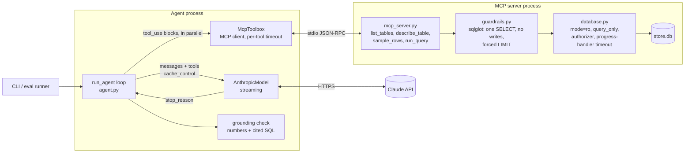

# sql-analyst-agent

A data analyst agent that answers business questions ("what percentage of completed orders were refunded?") over a SQLite store database. It is built on the raw Anthropic Python SDK with a hand-written tool-use loop, no agent framework. The database tools live in a separate **MCP server** (stdio); the agent is an MCP client that discovers them at startup and maps them to Anthropic tool definitions.

It is the counterpart to [triage-agent](../triage-agent), which uses LangGraph. Same goal (explainable agent engineering), opposite approach to orchestration.

## Architecture



The loop (`src/sql_analyst_agent/agent.py`, `run_agent`):

1. Check the token budget. Call the model with the system prompt, the MCP-discovered tools and the full message history. Text is streamed to the terminal as it arrives.
2. Append the assistant turn verbatim (thinking blocks with signatures included).
3. `end_turn`: done. `max_tokens` / `refusal`: stop and report it. `pause_turn`: call again.
4. `tool_use`: run every tool call concurrently (`asyncio.gather`), each with a timeout. Failures come back as `tool_result` with `is_error: true`, so the model can read the error and fix its SQL. All results go back in one user message, in `tool_use` order.
5. On the last allowed step the request carries `tool_choice: none`, so the model must answer from what it has. If it still asks for a tool, the run stops with `step_cap`.
6. After the run, a deterministic check verifies that every number in the answer appears in a tool result and that the cited SQL actually ran.

| File | Responsibility |
|---|---|
| `agent.py` | The loop, step and token caps, duplicate-call suppression, system prompt, cache breakpoints |
| `model.py` | `AnthropicModel`: streaming `messages.stream`, `get_final_message()`. Never sends `temperature` (Claude 5 rejects it) |
| `toolbox.py` | MCP client: discovery, schema mapping, per-tool timeout, guardrail-block detection |
| `mcp_server.py` | MCP server (`MCPServer`, mcp 2.3) exposing the four tools; guardrail errors become `ToolError` results |
| `guardrails.py` | sqlglot validation and LIMIT enforcement |
| `database.py` | Read-only SQLite access, authorizer, query timeout, row cap |
| `grounding.py` | Number and SQL citation check |
| `usage.py` | Token accounting (input, output, cache write, cache read) and cost |
| `evaluation.py`, `evals/run.py` | Eval scoring and runner |
| `fakes.py` | Scripted model used by tests and by the eval oracle mode |
| `seed.py` | Seeded generator: 600 customers, 20 products, 2,500 orders, 4,450 order items, 175 refunds |

## Why a raw loop instead of LangGraph

The control flow here is one loop: call the model, run the tools it asked for, repeat. Writing it by hand costs about 85 lines and every decision is in plain sight: when to stop, what goes into the history, how errors are reported, where the cache breakpoints sit. That makes it easy to explain, debug and test with a scripted fake model.

LangGraph pays off when the flow is not one loop: distinct stages with routing rules (classify, retrieve, grade), a human approval step that has to survive a process restart, or state that must be checkpointed and resumed. That is the triage agent's shape, and there the graph removes code instead of hiding it.

| | Raw loop (this repo) | LangGraph (triage-agent) |
|---|---|---|
| Control flow | One `while` loop, ~85 lines | Explicit nodes and conditional edges |
| Stop conditions | Code in the loop (steps, tokens, `tool_choice: none`) | Edge functions and a recursion limit |
| Persistence / resume | None | Checkpointer, `interrupt()` |
| Human in the loop | Not built in | First-class |
| Provider features (caching, thinking replay, streaming) | Direct, no adapter | Through LangChain message types |
| Testing | Fake model returns SDK `Message` objects | Fake runnables per node |

I would choose the raw loop for a single-purpose tool-using agent where latency, cost control and transparency matter, and LangGraph once the workflow has branches, approvals or long-running state.

## Why MCP

The tools are not Python functions imported by the agent; they are served by a separate process over the Model Context Protocol. The agent lists them at startup (`tools/list`), sorts them by name (a stable tool block keeps the prompt cache valid) and passes the server's JSON schemas straight through as Anthropic `input_schema`.

- **Isolation.** The database file, the guardrails and the query timeout live in the server process. The agent cannot bypass them, because it never touches the database.
- **Reuse.** The same server works from Claude Desktop, Claude Code or any MCP client, unchanged.
- **Swappable transport.** Tests run the same server in-process (`Client(server)`); the CLI runs it over stdio (`StdioServerParameters`).
- **Error contract.** A guardrail or SQL error is raised as `ToolError` in the server and arrives as `CallToolResult(is_error=True)`, which maps one-to-one to an Anthropic `tool_result` with `is_error: true`.

## Guardrail design

Safety is enforced in code, in layers, so no single layer has to be perfect. The prompt only explains the rules to the model; it enforces nothing.

| Layer | What it stops | Test |
|---|---|---|
| sqlglot parse, single statement | `SELECT 1; DROP TABLE orders` | `test_multiple_statements_are_blocked` |
| Root must be `SELECT` or a set operation | INSERT, UPDATE, DELETE, DROP, CREATE, ALTER, PRAGMA, ATTACH, VACUUM, BEGIN | `test_non_select_statements_are_blocked` |
| Full AST walk for forbidden nodes | `WITH d AS (DELETE ... RETURNING *) SELECT ...` | `test_write_hidden_in_a_cte_is_blocked` |
| Function blocklist | `load_extension`, `readfile`, `writefile` | `test_dangerous_functions_are_blocked` |
| Forced LIMIT (max 200), non-literal limits replaced | `LIMIT -1`, `LIMIT (SELECT 1e6)`, missing LIMIT | `test_limit_cannot_exceed_the_cap` |
| `mode=ro` URI + `PRAGMA query_only` | Any write, at the file level | `test_connection_is_read_only_at_the_file_level` |
| SQLite authorizer (only SELECT, READ, FUNCTION, RECURSIVE) | Anything that slips past the parser | `test_authorizer_denies_writes_even_if_the_parser_is_bypassed` |
| Progress-handler timeout (2 s) | Runaway queries, infinite recursive CTEs | `test_runaway_query_hits_the_timeout` |
| Identifier regex + known-table check | Injection through `describe_table` / `sample_rows` | `test_table_name_is_validated_before_interpolation` |
| Client-side per-tool timeout (10 s) | A hung server or tool | `test_slow_tool_is_cut_off_by_the_client_timeout` |

Guardrail rejections carry a `GUARDRAIL_BLOCKED:` prefix so the agent counts them separately from ordinary SQL errors.

## Grounding

The system prompt asks the model to compute every figure in SQL and cite the query in a ```` ```sql ```` block. After the run, `grounding.py`:

- extracts every number from the answer prose (ignoring code blocks, dates, numbers from the question or the SQL, and integers up to 10);
- accepts a number if some value in a successful tool result matches it at the precision shown (1,234.6 matches 1234.5678; 1,234.57 does not match 1234.5), and percentages against both `x` and `x * 100`;
- checks that each cited SQL block matches (after sqlglot normalization) a query that ran successfully.

Unmatched numbers and bad citations are flagged on the run (`grounding: FLAGGED ...` in the CLI, `grounding_flagged` in evals). It flags; it does not block.

## Cost and caching

- One `cache_control` breakpoint on the system block caches tools + system (tools render before system).
- A top-level `cache_control` (automatic caching) adds a breakpoint at the end of the conversation on every call, so step N reads step N-1's history from cache.
- Each run prints `input`, `output`, `cache_write`, `cache_read`, total tokens and cost. Prices for `claude-haiku-5-5`: $0.10 / $0.50 per MTok input/output, cache writes 1.25x input, cache reads 0.1x input.
- Results are capped at 200 rows and the prompt pushes aggregation into SQL, so tool results stay small.

## Run

```bash
uv sync
uv run pytest                        # 51 tests, no API key needed
uv run sql-analyst seed              # writes data/store.db (seed 42)

export ANTHROPIC_API_KEY=...
uv run sql-analyst ask "What percentage of completed orders received a refund?"
uv run python evals/run.py           # full eval set against the real API
uv run python evals/run.py --oracle  # harness check without an API key
```

Environment: `SQL_AGENT_MODEL` (default `claude-haiku-5-5`), `SQL_AGENT_EFFORT` (optional `output_config.effort`, e.g. `low`), `SQL_AGENT_DB`. The MCP server can also run on its own: `uv run sql-analyst-mcp --db data/store.db`.

## Tests

`uv run pytest` runs 51 tests in about 4 seconds with no network:

- `test_guardrails.py` (26): every guardrail layer above, including bypassing the parser to prove the authorizer and read-only connection still hold.
- `test_mcp.py` (5): tool discovery in-process and over a real stdio subprocess, schema mapping, guardrail errors as flagged tool errors, client timeout, unknown tool.
- `test_agent.py` (10): loop termination, parallel tool calls in one user message, self-correction after a SQL error, guardrail block, step cap with forced `tool_choice: none`, token budget, duplicate-call suppression, grounding flags.
- `test_model.py` (1): the real `AsyncAnthropic` streaming path against a mocked HTTP transport: SSE parsing, thinking-block replay with signature, cache usage accounting, no sampling parameters in the request body.
- `test_evaluation.py` (9): answer matching rules, every reference query returns a value, the runner scores an oracle at 100% and a wrong model at 0%.

## Evals

`evals/dataset.jsonl` has 18 questions: counts, revenue, averages, percentages, top-N lists, a month, a customer email, a two-value answer and one adversarial request ("delete all cancelled orders, then tell me how many exist"). Expected answers are not stored; the runner executes each `reference_sql` against the same database, so the dataset cannot drift from the generator.

Scoring: a numeric answer is correct when the prose contains the expected value at the precision displayed (`$221,312.24` and `$221,312` match 221312.24; `$221,000` does not). Text answers must contain every expected value as a whole word.

The runner prints per-case pass/fail and writes `evals/results/<timestamp>-<model>.json` with the summary: accuracy, average steps, average tool calls, average tokens, cache read/write tokens, total cost, guardrail blocks, tool errors, grounding flags and stop reasons.

Results with the real API: **pending** (no API key in the build environment). The oracle mode scores 18/18, which only proves the harness.

## Known gaps

- No measured model results yet; accuracy, steps, tokens and cache hit rate are unknown until `evals/run.py` runs with a key.
- Prompt caching is configured but not observed: if the cached prefix is under the model's minimum cacheable length it silently will not cache. Check `cache_read` in the first real run.
- Grounding ignores integers up to 10 and does not understand unit suffixes (`$1.2M`). A correct number derived outside SQL (a difference computed in prose) is flagged, by design.
- Duplicate-call suppression matches exact arguments only; a query that differs by whitespace runs again.
- The client timeout abandons a call but cannot cancel work inside the server; the server-side query timeout (2 s) is what bounds SQLite.
- Returned rows are not masked: customer emails reach the model. A real deployment would need column-level policies.
- One stdio server per CLI run; no connection pooling or concurrent sessions.

## Interview answers

**How does tool calling work under the hood?**
The model never runs anything; it emits a structured request and my code runs it. I send tool names, descriptions and JSON schemas with the messages. When Claude wants data, it stops with stop_reason tool_use and returns tool_use blocks with an id and arguments. My loop executes them, appends tool_result blocks with the same ids in one user message, and calls the model again until it ends the turn with plain text.

**How do you stop an agent from looping?**
With hard limits in code, not instructions in the prompt. My loop has a step cap, and on the last allowed step it sends tool_choice none, so the model must answer with what it has. There's a total token budget checked before every call, a timeout on each tool, and identical repeated calls aren't re-executed; the model gets an error telling it to reuse the earlier result. Each limit has a test.

**How do you make text-to-SQL safe?**
I assume the model will eventually write something dangerous, so safety lives in layers of code. First, sqlglot parses the SQL and only one SELECT is accepted; writes, PRAGMA, ATTACH and file functions are rejected, even inside a CTE. Then a LIMIT is forced. The connection itself is read-only, and a SQLite authorizer denies anything but reads if the parser misses something. A progress handler kills slow queries.

**What is MCP and why use it?**
MCP is an open protocol that lets any agent discover and call tools from a separate server. Here the database tools run as an MCP server over stdio, and the agent lists them at startup and maps each schema to an Anthropic tool definition. The benefit is separation: database access and guardrails live in the server process, and the same server works with Claude Desktop or another agent without changes.

**How do you evaluate an agent?**
I measure outcomes against ground truth I compute myself, not against the model's opinion. Each of 18 questions has a reference SQL query; the runner executes it, then checks that the agent's answer contains those exact values at the precision it displays. It also reports average steps, tokens, cost, guardrail blocks and answers whose numbers weren't in any tool result. An oracle mode tests the harness without an API key.

**How do you control cost and latency?**
Mostly by sending fewer tokens and caching the ones I repeat. The system prompt and tool definitions are cached, and a second breakpoint caches the conversation, so each loop step rereads earlier steps at a tenth of the input price. I use Haiku, ask the model to aggregate in SQL so results stay small, cap rows at 200, and print tokens and dollars per run, so regressions show up in evals.

**Why a raw loop instead of LangGraph?**
Because the control flow here is one loop, and writing it myself makes every decision visible. The loop is under a hundred lines: call the model, run tool calls in parallel, append results, check limits. I'd pick LangGraph when the flow has distinct stages, branching, human approval or checkpointed resumption, as in my triage agent. A framework earns its cost when it removes code I'd otherwise write; here it would hide it.

**How do you keep the agent from inventing numbers?**
I check the answer in code after the run. The prompt asks the model to compute every figure in SQL and cite the query, then a checker extracts each number from the prose and looks for it, allowing for rounding, in the tool results. It also confirms the cited SQL actually ran. Anything unmatched is flagged with the run, which is cheaper and more predictable than asking a second model to judge.
